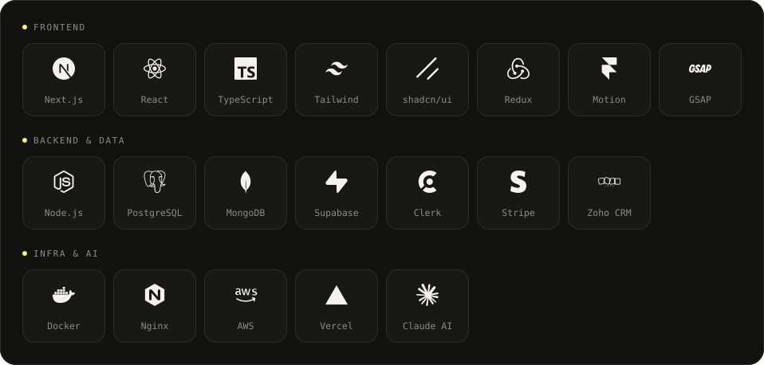

## Hi, I'm Toki

**Software engineer with an eye for design.** I build SaaS products, business tools, CRMs and complex web apps, keep them running, and care as much about how they look as how they work.

> _"Clear communication, daily updates, no surprises."_

---

## About Me

- Currently working as a **Software Developer at Easygrow Digital**
- **3+ years** building end to end, across 4 companies and my own freelance clients
- **20+ projects shipped**: marketing sites, marketplaces, dashboards and CRM tools
- AI integrations, like chatbots trained on your own content
- Connecting products to the tools teams already use: Zoho CRM, Stripe, booking systems, email automation

## Tech Stack

## Featured Work

| Project | What I did |
|---|---|
| **Picture TV Media** · New York, NY | Took a client prototype to a full media platform for events, video, bookings and sponsors. Added an AI chatbot and upgraded to a patched Next.js. |
| **Redaxify** · Logic Matrix LLC, US | Built three interfaces for an AI redaction platform. |

Full case studies on **[tokiosman.com](https://tokiosman.com)**

## Let's Work Together

Thanks for visiting!
